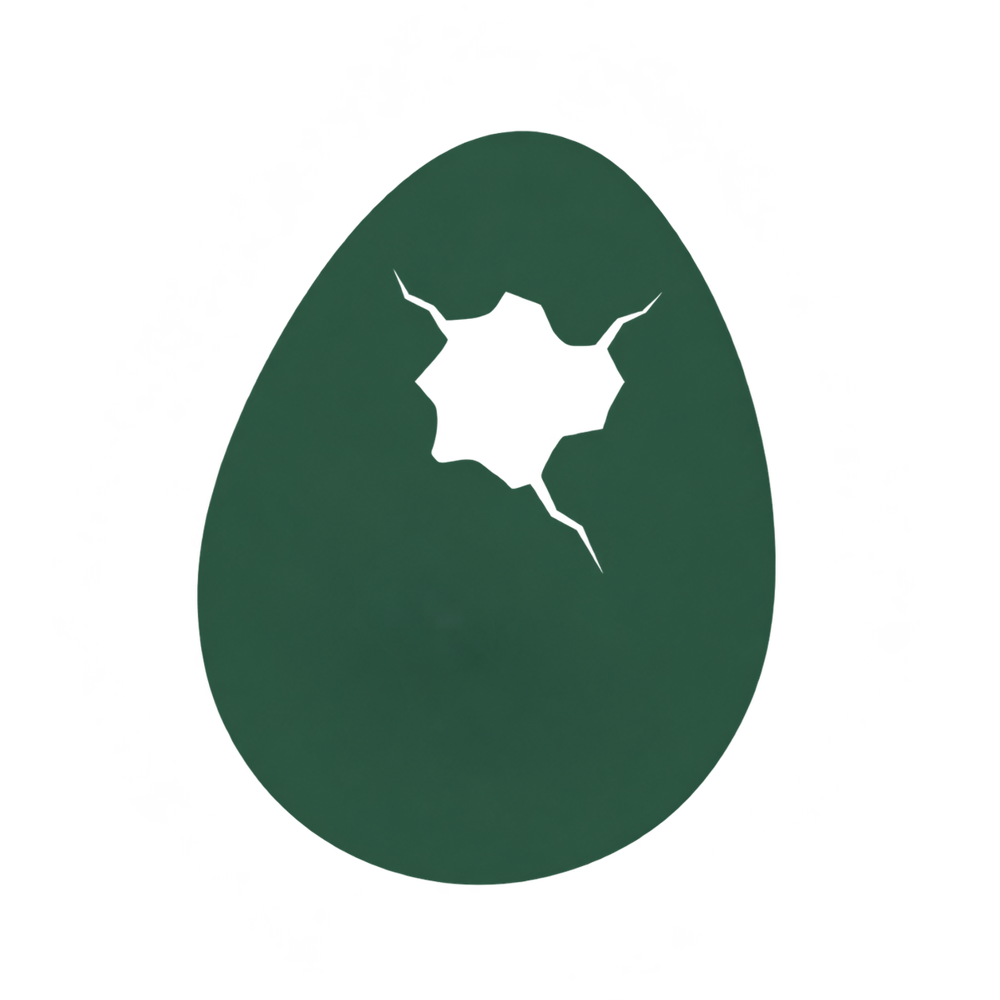

<h1>
  <picture>
    <source media="(prefers-color-scheme: dark)" srcset="./public/img/logo.png">
    <source media="(prefers-color-scheme: light)" srcset="./public/img/logo.png">
    
  </picture>&ensp;dino-ovum
</h1>

Shared Docusaurus presets and themes for dino-nest.

[](./LICENSE)
[](https://github.com/RichardLitt/standard-readme)

Keep your documents, branding, and settings in your own site. Dino Ovum brings shared
features and design to dino-nest through the preset and theme packages.

<div align="center">
<table align="center">
  <tr>
    <td align="center"><a href="language/eng/README.md"></a></td>
    <td align="center"><a href="language/ko/README.md"></a></td>
    <td align="center"><a href="language/jp/README.md"></a></td>
  </tr>
</table>
</div>

Design and implementation documents are maintained in Korean in `docs/`.

## Table of Contents

- [Specifications](#specifications)
- [Install](#install)
- [Usage](#usage)
- [Features](#features)
- [Maintainer](#maintainer)
- [Contributing](#contributing)
- [License](#license)

## Specifications

Dino Ovum's package structure and responsibilities:

| Component | Package | Description |
| --- | --- | --- |
|  | `@dino-ovum/preset` | Shared site configuration, document and sidebar setup, search, PWA, navigation, and recent-update plugins |
|  | `@dino-ovum/theme` | Shared UI, components, layouts, styles, fonts, and default UI translations |

## Install

This repository currently contains documentation and project branding. Package extraction and publication are not complete, so package installation commands are not available yet.

See the [implementation plan](./docs/implementation-plan.md) for the work stages and verification criteria.

## Usage

Use [dino-nest](https://github.com/4BFC/dino-nest) as the template for your own document site. Dino Ovum is the repository for developing and releasing its shared packages.

The target relationship is:

```text
dino-nest
  → @dino-ovum/preset
      → @dino-ovum/theme
```

Documents, logos, site settings, and custom CSS stay in the user project. Shared improvements reach the site through a package update, a build check, and redeployment.

The [architecture document](./docs/architecture.md) explains repository boundaries and customization.

## Features

The package design covers:

- Shared document, search, PWA, and sidebar configuration.
- Navigation and recent-update data generation.
- Shared layouts, components, styles, and fonts.
- Default UI translations and user customization.

The first implementation milestone is a verification site using the packaged artifacts. See the [implementation plan](./docs/implementation-plan.md) for the current status.

## Maintainer

[4BFC](https://github.com/4BFC)

## Contributing

Questions and bug reports are welcome in [GitHub Issues](https://github.com/4BFC/dino-ovum/issues).
Read the [architecture](./docs/architecture.md) and [implementation plan](./docs/implementation-plan.md) before proposing package changes.

## License

[Unlicense](./LICENSE).
Third-party assets and dependencies retain their own licenses and notices.
