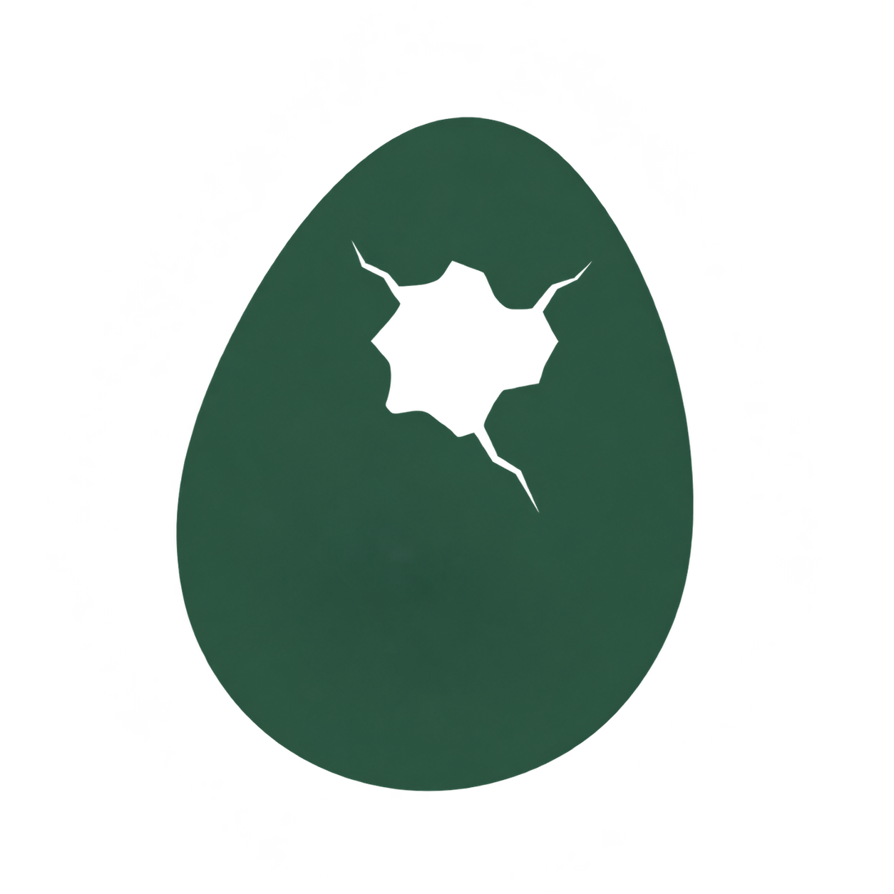

<h1>
  <picture>
    <source media="(prefers-color-scheme: dark)" srcset="../../public/img/logo.png">
    <source media="(prefers-color-scheme: light)" srcset="../../public/img/logo.png">
    
  </picture>&ensp;dino-ovum
</h1>

dino-nest のための共通 Docusaurus preset と theme です。

[](../../LICENSE)
[](https://github.com/RichardLitt/standard-readme)

文書、ブランド、サイト設定は自分のプロジェクトで管理できます。Dino Ovum は preset と theme
パッケージを通じて、dino-nest の共通機能とデザインを提供します。

<div align="center">
<table align="center">
  <tr>
    <td align="center"><a href="../eng/README.md"></a></td>
    <td align="center"><a href="../ko/README.md"></a></td>
    <td align="center"><a href="README.md"></a></td>
  </tr>
</table>
</div>

設計と実装の文書は `docs/` で韓国語として管理します。

## 目次

- [仕様](#仕様)
- [インストール](#インストール)
- [使い方](#使い方)
- [主な機能](#主な機能)
- [メンテナー](#メンテナー)
- [貢献](#貢献)
- [ライセンス](#ライセンス)

## 仕様

Dino Ovum のパッケージ構成と役割です。

| 構成 | パッケージ | 説明 |
| --- | --- | --- |
|  | `@dino-ovum/preset` | 共通サイト設定、文書・サイドバー構成、検索・PWA・ナビゲーション・最近の更新プラグイン |
|  | `@dino-ovum/theme` | 共通 UI・コンポーネント・レイアウト・スタイル・フォント・標準 UI 翻訳 |

## インストール

現在のリポジトリには文書とプロジェクトのブランド画像があります。パッケージの分離と公開はまだ完了していないため、インストールコマンドは提供していません。

作業段階と検証基準は[実装計画](../../docs/implementation-plan.md)を参照してください。

## 使い方

自分の文書サイトを作る場合は [dino-nest](https://github.com/4BFC/dino-nest) をテンプレートとして使います。Dino Ovum はその共通パッケージを開発・公開するリポジトリです。

目標とする関係は次のとおりです。

```text
dino-nest
  → @dino-ovum/preset
      → @dino-ovum/theme
```

文書・ロゴ・サイト設定・カスタム CSS は利用者のプロジェクトに残します。共通の改善はパッケージ更新、ビルド検証、再デプロイを経てサイトに反映します。

リポジトリの境界とカスタマイズ方法は[アーキテクチャ文書](../../docs/architecture.md)を参照してください。

## 主な機能

パッケージは次の役割で設計します。

- 文書・検索・PWA・サイドバーの共通設定。
- ナビゲーションと最近の更新データの生成。
- 共通レイアウト・コンポーネント・スタイル・フォント。
- 標準 UI 翻訳と利用者のカスタマイズ。

最初の実装完了点は、実際の配布形式のパッケージを使う検証サイトです。現在の状態は[実装計画](../../docs/implementation-plan.md)に記載します。

## メンテナー

[4BFC](https://github.com/4BFC)

## 貢献

質問や不具合は [GitHub Issues](https://github.com/4BFC/dino-ovum/issues) にお寄せください。
パッケージの変更を提案する前に、[アーキテクチャ](../../docs/architecture.md)と[実装計画](../../docs/implementation-plan.md)を確認してください。

## ライセンス

[Unlicense](../../LICENSE) を適用します。
外部の素材と依存パッケージはそれぞれのライセンスと表示事項を維持します。
