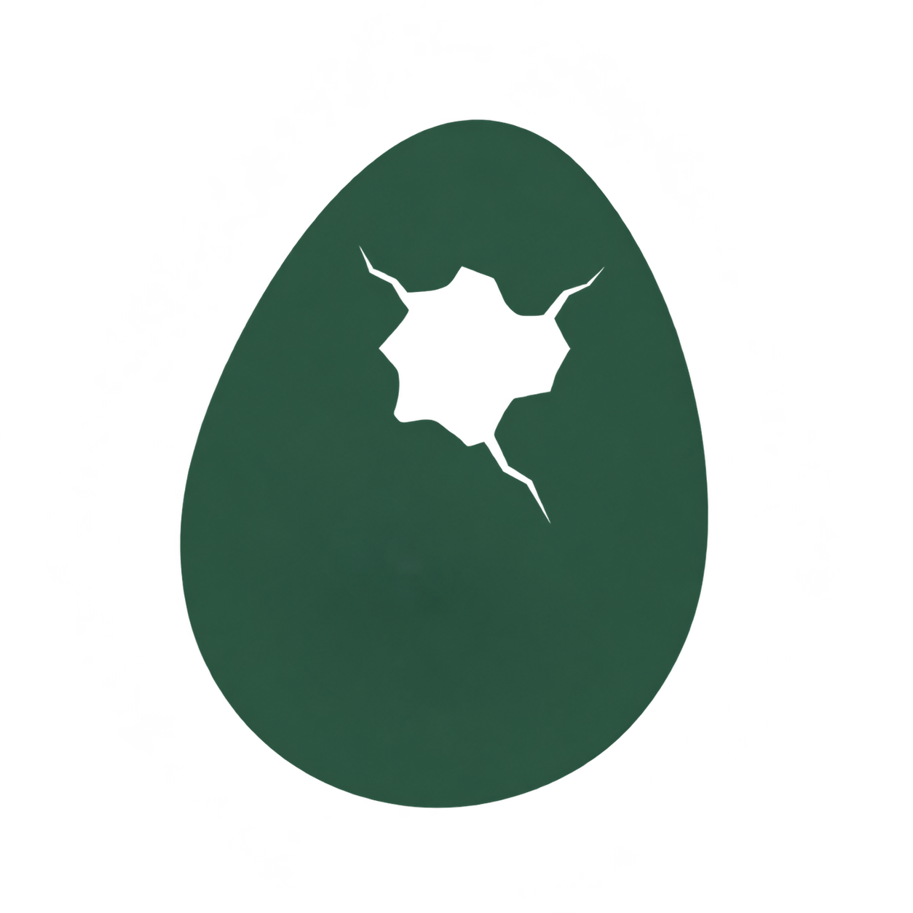

<h1>
  <picture>
    <source media="(prefers-color-scheme: dark)" srcset="../../public/img/logo.png">
    <source media="(prefers-color-scheme: light)" srcset="../../public/img/logo.png">
    
  </picture>&ensp;dino-ovum
</h1>

dino-nest를 위한 공통 Docusaurus preset과 theme입니다.

[](../../LICENSE)
[](https://github.com/RichardLitt/standard-readme)

문서와 브랜딩, 사이트 설정은 내 프로젝트에서 관리하세요. Dino Ovum은 preset과 theme
패키지를 통해 dino-nest의 공통 기능과 디자인을 제공합니다.

<div align="center">
<table align="center">
  <tr>
    <td align="center"><a href="../eng/README.md"></a></td>
    <td align="center"><a href="README.md"></a></td>
    <td align="center"><a href="../jp/README.md"></a></td>
  </tr>
</table>
</div>

설정 안내와 이전 안내는 `docs/`에서 한국어로 관리합니다.

## 목차

- [스펙](#스펙)
- [설치](#설치)
- [사용법](#사용법)
- [주요 기능](#주요-기능)
- [관리자](#관리자)
- [기여](#기여)
- [라이선스](#라이선스)

## 스펙

Dino Ovum은 두 패키지로 구성됩니다.

| 구성 | 패키지 | 설명 |
| --- | --- | --- |
|  | `@dino-ovum/preset` | 공통 사이트 설정, 문서·사이드바, 검색·PWA·탐색·최근 업데이트 |
|  | `@dino-ovum/theme` | 공통 UI·컴포넌트·레이아웃·스타일·폰트·기본 UI 번역 |

패키지의 지원 대상은 Docusaurus **3.10.1**, React **19**, Node.js **>=24.22.1 <25**입니다. 개발 workspace는 pnpm **10.5.2**를 사용합니다. 초기 버전은 문서 루트 하나를 지원합니다.

## 설치

Docusaurus 사이트에 preset을 설치합니다. 맞는 버전의 `@dino-ovum/theme`이 함께 설치됩니다.

```sh
pnpm add @dino-ovum/preset @docusaurus/core@3.10.1 @mdx-js/react react react-dom
```

패키지를 개발할 때는 Node.js와 pnpm을 준비한 뒤 이 저장소의 개발·검증용 사이트를 실행합니다.

```sh
git clone https://github.com/4BFC/dino-ovum.git
cd dino-ovum
nvm use
pnpm install --frozen-lockfile
pnpm start
```

`nvm use`는 `.nvmrc`의 Node.js 버전을 선택합니다. 이미 해당 버전을 사용 중이면 생략합니다.

배포하지 않은 변경을 다른 사이트에서 확인할 때는 `pnpm pack:packages`로 압축 파일을 만듭니다.

## 사용법

사이트 설정에서 preset을 연결합니다.

```js
import {createDinoConfig} from '@dino-ovum/preset/config';

export default createDinoConfig(
  {
    title: 'My documents',
    url: 'https://example.com',
    baseUrl: '/',
    themeConfig: {navbar: {logo: {src: 'img/logo.svg'}}},
  },
  {
    customCss: './src/css/custom.css',
    updates: true,
    pwa: false,
  },
);
```

문서는 `documents/`, 이미지는 `public/`, 사용자 스타일은 `src/css/custom.css`에 둡니다. preset이 공통 theme을 함께 불러옵니다. 검색은 기본 활성화이며 PWA와 최근 업데이트 페이지는 선택 기능입니다.

```text
사용자 사이트 (이전 후의 dino-nest)
  → @dino-ovum/preset
      → @dino-ovum/theme
```

`website/`는 공통 app이나 theme의 로컬 복사본 없이 이 구조로 실행됩니다. 패키지 버전을 올리면 사이트 파일을 유지하면서 공통 개선을 받을 수 있습니다. 이번 구현에서 기존 dino-nest 저장소를 이전하지는 않았습니다.

자세한 내용은 [설정 안내](../../docs/configuration.md)와 [이전 안내](../../docs/migration.md)를 참고하세요.

## 주요 기능

| 기능 | 설명 | 패키지 | 설정 (기본값) |
| --- | --- | --- | --- |
| 문서와 검색 | 공통 문서 설정, 자동 사이드바, 로컬 검색 | preset | `search` (켜짐) |
| 탐색과 최근 업데이트 | 문서 탐색과 최근 업데이트 페이지 | preset, theme | `updates` (꺼짐) |
| 디자인 | 공통 레이아웃, 스타일, Pretendard 폰트, 밝은/어두운 테마 | theme | 항상 적용 |
| 다국어 UI | 영어, 한국어, 일본어 UI와 사용자 번역 재정의 | theme | 첫 번째 인자의 `i18n` |
| PWA | manifest와 오프라인 기능, 하위 경로 배포 지원 | preset | `pwa` (꺼짐) |
| 사용자 커스텀 | 패키지 업데이트 후에도 유지되는 사용자 CSS와 컴포넌트 래퍼 | preset, theme | `customCss`, `src/theme/` |

```sh
pnpm build             # 세 언어 전체 빌드
pnpm serve             # 프로덕션 사이트 미리보기
pnpm check             # 린트, 단위 테스트, 사이트 빌드
pnpm verify:packages   # 독립된 사이트에서 압축 패키지 설치·업그레이드 검증
```

## 관리자

[4BFC](https://github.com/4BFC)

## 기여

질문과 버그 제보는 [GitHub Issues](https://github.com/4BFC/dino-ovum/issues)에 남겨 주세요.
패키지를 변경한 뒤에는 `pnpm check`와 `pnpm verify:packages`를 실행해 주세요.

## 라이선스

[MIT](../../LICENSE)를 적용합니다. 코드는 같은 라이선스와 저작권자를 가진 dino-nest에서 분리했습니다. 외부 에셋과 의존성은 각각의 라이선스를 유지합니다.
